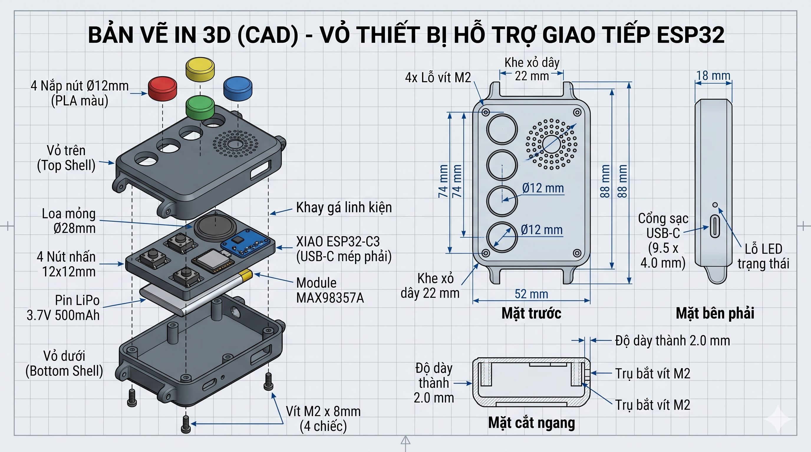

# 🗣️ Thiết Bị Hỗ Trợ Giao Tiếp 4 Nút Bấm Cho Người Tai Biến (ESP32)

Một chiếc máy phát giọng nói nhỏ gọn (đeo cổ tay như đồng hồ hoặc cầm tay) giúp người bệnh sau tai biến gặp khó khăn trong phát âm có thể **chỉ cần nhấn 1 trong 4 nút màu lớn** để phát ra ngay những câu nói sinh hoạt thiết yếu nhất cho người nhà nghe thấy.

---

## ✨ Điểm Nổi Bật Dễ Dùng Cho Gia Đình

* **Bấm là nói ngay, không cần bật tắt công tắc:** Thiết bị tự động đưa mạch vào trạng thái ngủ siêu tiết kiệm điện (`Light-sleep`) ngay sau khi đọc xong câu thoại. Khi người bệnh nhấn bất kỳ nút nào, máy thức dậy và phát tiếng gần như tức thì.
* **Pin dùng 7 – 14 ngày mới phải sạc một lần:** Sạc lại dễ dàng bằng dây sạc điện thoại **USB Type-C** phổ thông ngay cạnh hông máy (có đèn LED báo trạng thái sạc).
* **4 nút màu lớn tách biệt:** Phân màu rõ ràng (**Đỏ – Vàng – Xanh lá – Xanh dương**), khoảng cách tâm nút `15.2 mm`, giúp bàn tay yếu hoặc run vẫn bấm chính xác từng nhu cầu.
* **Thay đổi câu nói linh hoạt:** 4 câu thoại lưu trực tiếp trong bộ nhớ của chip (không cần thẻ nhớ rời), có thể đổi sang giọng người thân trong gia đình bất cứ lúc nào.

### Gợi ý 4 câu thoại mặc định theo màu nút

| Nút bấm | Màu nắp nút | Nội dung phát ra loa (gợi ý) |
| :--- | :--- | :--- |
| **Nút 1 (trên cùng)** | 🔴 **Đỏ** | *"Gọi người nhà giúp tôi với!"* |
| **Nút 2** | 🟡 **Vàng** | *"Cho tôi uống một ngụm nước."* |
| **Nút 3** | 🟢 **Xanh lá** | *"Tôi đói, cho tôi ăn cơm."* |
| **Nút 4 (dưới cùng)** | 🔵 **Xanh dương** | *"Giúp tôi đi vệ sinh."* |

---

## 🛒 Danh Sách Linh Kiện Cần Mua (Đúng Loại Để Lắp Vừa Vỏ)

Tổng chi phí toàn bộ linh kiện chỉ khoảng **200.000đ – 280.000đ** (có thể đặt mua trên Shopee, Lazada hoặc các tiệm linh kiện điện tử).

| STT | Tên linh kiện | Thông số bắt buộc để lắp vừa vỏ | Số lượng | Lưu ý quan trọng tránh mua nhầm |
| :---: | :--- | :--- | :---: | :--- |
| **1** | **Bo mạch Seeed Studio XIAO ESP32-C3** | Kích thước chuẩn `21 × 17.8 mm`, cổng USB-C | 1 cái | Chọn đúng dòng **XIAO** của Seeed Studio (đã có sẵn mạch sạc pin trên bo). **Không** mua bản thường chân dài. |
| **2** | **Mạch khuếch đại âm thanh MAX98357A** | Giao tiếp I2S, công suất 3W | 1 cái | Mua loại **chưa hàn sẵn cọc xanh (domino)** hoặc tháo bỏ cọc xanh để giữ độ mỏng `< 3.5 mm`. |
| **3** | **Loa mini mỏng** | Đường kính **Ø28 mm**, dày **4.5 – 5.0 mm**, `4Ω 2W` hoặc `8Ω 1W–2W` | 1 cái | Không mua loa tròn dày 23–30 mm vì sẽ không đóng vừa nắp vỏ đeo tay. |
| **4** | **Pin LiPo dẹt 3.7V** | Mã **`502535`** hoặc **`602535`** (`25 × 35 × 5~6 mm`), dung lượng `400–500 mAh` | 1 viên | **Bắt buộc** chọn loại có **mạch bảo vệ (PCM)** bọc băng keo vàng ở đầu pin để chống xả cạn làm hỏng pin. |
| **5** | **Nút nhấn vuông (Tactile Switch)** | Kích thước **`12 × 12 × 5 mm`** (4 chân xuyên lỗ) | 4 cái | Nên chọn loại **lực nhấn nhẹ (soft tactile)** để người tay yếu bấm không bị mỏi. |
| **6** | **Ốc vít đầu chìm M2** | Vít **`M2 × 8 mm`** (đầu bằng hoặc đầu trụ nhỏ) | 4 con | Dùng để bắt cố định 2 nửa vỏ từ mặt đáy. |
| **7** | **Dây đeo đồng hồ** | Bản rộng **`22 mm`** (dây vải dán Velcro hoặc dây silicone) | 1 bộ | Dây dán Velcro giúp người nhà dễ tháo lắp vào cổ tay người bệnh nhất. |

### Dụng cụ cần chuẩn bị thêm
* Mỏ hàn thiếc, thiếc hàn, nhựa thông và dây điện mềm lõi nhỏ (loại dây **AWG 28 hoặc AWG 30** vỏ silicone rất dễ đi dây gọn trong hộp).
* Một ít keo nến hoặc băng dính hai mặt xốp mỏng để cố định pin và loa.
* Tua-vít 4 cạnh đầu nhỏ (loại sửa kính/điện thoại) để vặn ốc M2.

---

## 🖨️ Hướng Dẫn In 3D Vỏ Thiết Bị (Gửi Tiệm In Nếu Không Có Máy)

File thiết kế vỏ đã được dựng sẵn tại **`vo_thiet_bi_esp32_xiao.scad`** với kích thước thân **`74 × 52 × 18 mm`** (tính cả 2 tai xỏ dây đeo là `88 mm`). Thiết kế đã tối ưu để **in không cần chân đỡ (0% support)**.

### Cách xuất file `.stl` từ OpenSCAD
1. Tải và cài phần mềm miễn phí **OpenSCAD** trên máy tính.
2. Mở file `vo_thiet_bi_esp32_xiao.scad`.
3. Ở đầu file, tìm dòng `render_part = "print_bed";` và lần lượt đổi giá trị rồi nhấn **F6 (Render)** → **File → Export → Export as STL**:
   * `"bottom_shell"` → lưu thành **`vo_duoi.stl`** (1 cái)
   * `"top_shell"` → lưu thành **`vo_tren.stl`** (1 cái — đã tự động lật úp mặt loa xuống bàn in)
   * `"button_caps"` → lưu thành **`4_nap_nut.stl`** (hoặc dùng `"single_cap"` nếu muốn in 4 màu Đỏ / Vàng / Xanh lá / Xanh dương riêng)

### Mẫu tin nhắn gửi tiệm dịch vụ in 3D
> *"Nhờ shop in giúp mình 3 file STL này bằng nhựa **PLA+** hoặc **PETG** (màu xám đậm hoặc đen). Thông số: vòi phun `0.4 mm`, chiều cao lớp **`0.2 mm`**, độ đặc **`20%`**, **không cần bật support** vì file đã tối ưu mặt phẳng. Riêng file nắp nút nhờ shop in giúp 4 màu: Đỏ, Vàng, Xanh lá, Xanh dương."*

---

## 🔌 Hướng Dẫn Đấu Nối Dây Điện (Từng Bước Cho Người Mới)

> ⚠️ **Cảnh báo an toàn trước khi hàn:** **Luôn hàn dây pin LiPo ở bước CUỐI CÙNG**, và kiểm tra thật kỹ cực **Đỏ (`+`)** – **Đen (`-`)** trước khi chạm mỏ hàn. Đấu ngược cực pin sẽ làm cháy mạch sạc trên XIAO ngay lập tức.

### Bảng nối chân tổng hợp (tổng cộng chỉ có 11 mối hàn)

| Cụm linh kiện | Điểm hàn trên linh kiện | Nối tới điểm hàn trên **XIAO ESP32-C3** | Ghi chú dễ nhớ |
| :--- | :--- | :--- | :--- |
| **4 Nút nhấn** | 1 chân bất kỳ của Nút 1 | **`D1`** | Nút trên cùng (Đỏ) |
| **4 Nút nhấn** | 1 chân bất kỳ của Nút 2 | **`D2`** | Nút thứ 2 (Vàng) |
| **4 Nút nhấn** | 1 chân bất kỳ của Nút 3 | **`D3`** | Nút thứ 3 (Xanh lá) |
| **4 Nút nhấn** | 1 chân bất kỳ của Nút 4 | **`D4`** | Nút dưới cùng (Xanh dương) |
| **4 Nút nhấn** | Chân đối diện của cả 4 nút | **`GND`** | Nối chung 4 chân này thành 1 dây về `GND` |
| **Mạch loa MAX98357A** | Chân **`BCLK`** | **`D5`** | Dây tín hiệu âm thanh 1 |
| **Mạch loa MAX98357A** | Chân **`LRC`** | **`D6`** | Dây tín hiệu âm thanh 2 |
| **Mạch loa MAX98357A** | Chân **`DIN`** | **`D7`** | Dây tín hiệu âm thanh 3 |
| **Mạch loa MAX98357A** | Chân **`SD`** | **`D10`** | Dây tắt/mở loa tự động để tiết kiệm pin |
| **Mạch loa MAX98357A** | Chân **`GND`** | **`GND`** | Nối chung mass với XIAO và nút bấm |
| **Mạch loa MAX98357A** | Chân **`GAIN`** | *Để trống (không hàn)* | Mặc định 9 dB (vừa đủ rõ, không rè) |
| **Loa mini Ø28mm** | 2 cực `+` và `-` của loa | 2 lỗ **`+`** và **`-`** trên mạch MAX98357A | Hàn thẳng dây vào lỗ trên mạch |
| **Pin LiPo 3.7V** | **Dây Đỏ (`+`)** | Pad **`BAT+`** (mặt lưng XIAO) **VÀ** chân **`VIN`** của MAX98357A | Chia làm 2 nhánh cấp nguồn |
| **Pin LiPo 3.7V** | **Dây Đen (`-`)** | Pad **`BAT-`** (mặt lưng XIAO) **VÀ** đường **`GND`** chung | Nối chung toàn bộ dây âm |

### Mẹo hàn gọn cho người chưa quen
1. **Nạp code trước khi hàn:** Cắm cáp USB-C vào bo XIAO ESP32-C3 để nạp chương trình và chép 4 file âm thanh vào trước, thử cắm thử loa xem đã kêu chưa rồi mới đặt vào vỏ.
2. **Đo độ dài dây theo vỏ:** Đặt ướm các linh kiện vào đúng hốc trên vỏ in 3D để cắt dây vừa đủ dài (thừa khoảng `1.5–2 cm` để gập gọn khi đóng nắp), tránh cắt dây quá dài gây cộm.
3. **Hàn mặt lưng XIAO cẩn thận:** Hai điểm `BAT+` và `BAT-` nằm ở **mặt dưới** của bo XIAO (ngay phía dưới cổng USB-C). Tráng sẵn một chút thiếc lên pad trước khi chấm dây pin vào.

---

## 🧩 Thứ Tự Lắp Ráp Vào Vỏ In 3D

1. **Thông lỗ ốc đáy vỏ dưới:** Trên `vo_duoi`, 4 lỗ ốc góc có sẵn một lớp màng nhựa mỏng `0.2 mm` giúp in không cần chân đỡ. Dùng mũi tua-vít nhọn hoặc chính con ốc M2 chọc thủng nhẹ lớp màng này.
2. **Lắp phần vỏ trên (`vo_tren`):**
   * Thả 4 nắp nút màu vào 4 lỗ tròn từ mặt trong vỏ trên (vành rộng của nắp nút sẽ tự giữ nắp không bị tụt ra ngoài).
   * Đặt loa Ø28 mm vào vành tròn (mặt màng loa úp xuống lưới lỗ), chấm 1 giọt keo nến ở mép ngoài để cố định.
   * Đặt mạch **MAX98357A** vào khay chữ nhật ở góc dưới bên phải mặt trong vỏ trên.
3. **Lắp phần vỏ dưới (`vo_duoi`):**
   * Ấn 4 công tắc `12×12 mm` vào 4 hốc vuông bên cột trái.
   * Đặt bo **XIAO ESP32-C3** lên 2 thanh ray ở góc dưới bên phải, đẩy sát đầu cổng sạc **USB-C** lọt khớp vào khe hở bên thành phải.
   * Đặt viên pin LiPo vào khoang trống phía trên XIAO (dán 1 miếng băng dính 2 mặt mỏng dưới đáy pin cho chắc chắn).
4. **Đóng nắp và kiểm tra:**
   * Gấp gọn các sợi dây vào khoảng trống giữa các linh kiện, tránh để dây kẹt lên đỉnh 4 trụ ốc góc hoặc đè lên nút bấm.
   * Úp `vo_tren` khớp vào rãnh viền của `vo_duoi`, bấm thử 4 nút xem có tiếng kêu *"tách"* nảy đều và phát tiếng rõ ràng không.
   * Vặn 4 ốc **`M2 × 8 mm`** từ mặt đáy và luồn dây đeo `22 mm` qua 2 tai vỏ.

---

## 🛠️ Xử Lý Nhanh Một Số Lỗi Thường Gặp

| Hiện tượng | Nguyên nhân phổ biến | Cách khắc phục |
| :--- | :--- | :--- |
| **Bấm nút không kêu gì** | Pin đang cạn điện hoặc dây chân `SD` (D10) bị tuột | Cắm cáp sạc USB-C trong 30 phút (đèn cam/đỏ trên bo XIAO sáng là đang sạc), sau đó thử lại. |
| **Tiếng nói hơi nhỏ trong phòng rộng** | Mức khuếch đại mặc định `9 dB` chưa đủ lớn | Hàn thêm 1 đoạn dây ngắn nối chân **`GAIN`** của mạch MAX98357A sang chân **`GND`** để tăng lên `12 dB`. |
| **Nắp nút bấm bị kẹt, không nảy lên** | Nhựa in 3D hơi nở làm khít lỗ `Ø12.6 mm` | Dùng giấy nhám mịn (loại P400–P600) chà nhẹ quanh thân trụ tròn của nắp nút hoặc mở rộng lỗ vỏ thêm một chút. |
| **Cắm sạc vào máy tính không nhận cổng** | Dùng nhầm dây cáp chỉ có tính năng sạc (không có dây dữ liệu) | Đổi sang cáp USB-C truyền dữ liệu chuẩn; nếu vẫn chưa nhận, giữ nút **BOOT** trên bo XIAO trong lúc cắm cáp. |
